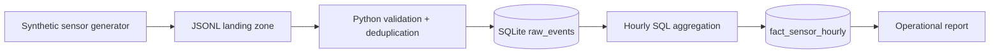

# Architecture and design decisions

## Local MVP
The loader is repeatable: the primary key prevents duplicate event IDs and aggregations are recomputed each run. It rejects invalid data and handles missing keys. SQLite is intentionally used to make the demonstration reproducible without cloud credentials.

## Production extension (not deployed)
- Land immutable events in S3 and ingest streaming events through MSK/Kafka.
- Replace SQLite with managed PostgreSQL or a columnar warehouse.
- Orchestrate transformations with Airflow; apply dbt models and quality checks.
- Add telemetry, dead-letter handling, schema evolution and data retention.
- Restrict IAM roles, encrypt data at rest and in transit, and monitor data latency.

## Limitations
No real-time ingestion, distributed processing, replay checkpoints or guaranteed delivery. Threshold flags are heuristics, not validated industrial diagnoses.
